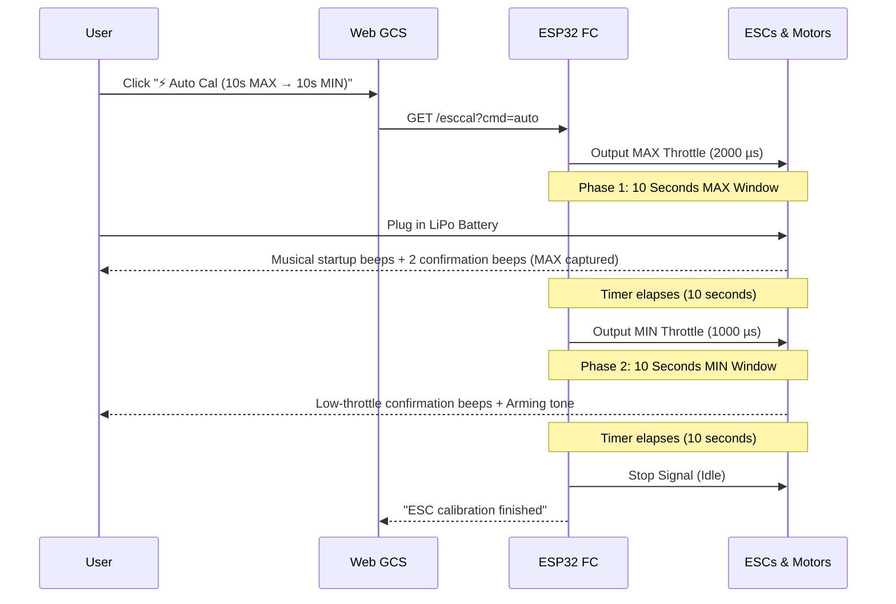

# 🛸 ESP32 Autonomous Quadcopter Flight Controller (v3)

[](https://www.espressif.com/en/products/socs/esp32)
[](https://github.com/espressif/arduino-esp32)
[](https://www.freertos.org/)
[](https://github.com/povlhp/IBusBM)
[](#-embedded-web-ground-control-station)
[](LICENSE)

An advanced, self-contained **autonomous quadcopter flight controller** engineered for the **ESP32** dual-core microcontroller. It integrates a 250 Hz deterministic flight loop, 14-channel FlySky iBUS radio control, bidirectional iBUS telemetry, autonomous GPS position hold and Return-To-Home (RTH), an embedded responsive Web Ground Control Station (GCS), live Flash-saved PID tuning, programmable Aux I/O (switches, strobes, and 50 Hz PWM servos), and a 10-second automated ESC calibration routine.

---

## 📑 Table of Contents
- [Key Features](#-key-features)
- [Hardware & Pinout Specification](#-hardware--pinout-specification)
  - [Pinout Table](#pinout-table)
  - [Battery Voltage Divider](#battery-voltage-divider-schematic)
  - [Motor Layout (Quad-X)](#motor-layout-quad-x)
- [System Architecture](#-system-architecture)
  - [Dual-Core Task Separation](#dual-core-task-separation)
- [Flight Modes & Autonomous Navigation](#-flight-modes--autonomous-navigation)
- [FlySky 14-Channel iBUS & Telemetry](#-flysky-14-channel-ibus--telemetry)
  - [Auxiliary Channel Assignable Functions](#auxiliary-channel-assignable-functions)
  - [iBUS FlyPlus Telemetry (GPIO 27)](#ibus-flyplus-telemetry-gpio-27)
- [Embedded Web Ground Control Station](#-embedded-web-ground-control-station)
- [ESC & Sensor Calibration](#-esc--sensor-calibration)
  - [10-Second Auto ESC Calibration](#10-second-auto-esc-calibration)
- [Installation & Flashing](#-installation--flashing)
  - [Prerequisites & Libraries](#prerequisites--libraries)
  - [Arduino IDE Configuration](#arduino-ide-configuration)
- [REST API Endpoints](#-rest-api-endpoints)
- [Safety & Pre-Flight Checklist](#-safety--pre-flight-checklist)

---

## ⚡ Key Features

* **High-Speed 250 Hz Flight Control Loop**: Hardware timer/microsecond-paced deterministic loop (4000 µs period) on Core 1 for ultra-low latency attitude estimation and PID motor commands.
* **Dual-Core FreeRTOS Architecture**:
  * **Core 1**: Real-time IMU sampling, complementary attitude fusion, cascaded angle/rate PID controllers, GPS/altitude navigation, and 250 Hz hardware LEDC PWM motor output.
  * **Core 0**: FlySky iBUS receiver packet parsing (`ibusTask`, Priority 3), half-duplex iBUS telemetry transmitter, WiFi Station & AP fallback, HTTP WebServer, and ArduinoOTA firmware flashing.
* **FlySky 14-Channel iBUS Support**:
  * Channels 1–4 dedicated to flight sticks (Roll, Pitch, Throttle, Yaw).
  * Channels 5–14 (10 Aux channels) fully assignable from the Web UI to 14 distinct functions.
* **Bidirectional iBUS Telemetry**: Transmits battery voltage, GPS coordinates, altitude, distance to home, ground speed, heading, satellite count, and motor status back to the FlySky transmitter (FlyPlus 1.7.6 compatible).
* **Autonomous GPS Navigation**:
  * Automatic Home-point capture on Arming.
  * **GPS Position Hold**: Locks 3D coordinates using cascaded position/velocity PID controllers and barometric altitude hold.
  * **Return-To-Home (RTH)**: Automatic climb to safe altitude -> straight flight to home -> automated touchdown descent -> auto-disarm.
* **Embedded Web Ground Control Station (GCS)**:
  * 100% offline; stored directly in ESP32 Flash memory (`PROGMEM`).
  * Real-time flight instruments (artificial horizon, compass heading, motor bars, altitude).
  * Dual virtual touch joysticks & keyboard flying controls (W/A/S/D, Arrow keys, Space = KILL).
  * Live PID, rate, expo, failsafe, battery, and navigation tuning with 1-click NVS Flash persistence.
* **Programmable Auxiliary I/O**:
  * GPIO 26, 25, 32 configurable as Digital Outputs, High-Visibility Strobes/Flasher, or 50 Hz RC Servo PWM outputs.
  * GPIO 34, 36 (VP), 39 (VN) live analog/digital input voltage monitoring.
* **10-Second Auto ESC Calibration**: Single-click automated calibration routine driving MAX throttle for 10 s, followed automatically by MIN throttle for 10 s with live visual progress feedback.
* **Comprehensive Multi-Level Safety**:
  * Crash angle detection (> 75° tilt initiates instant disarm).
  * Arming angle & throttle interlocks (drone must be level < 12° and throttle at 0).
  * Link loss & low battery failsafe (triggers configurable auto-RTH or emergency disarm).

---

## 🔌 Hardware & Pinout Specification

### Pinout Table

| GPIO | Function | Type | Description |
| :--- | :--- | :--- | :--- |
| **GPIO 2** | **Motor 1 (FR)** | Output | Front-Right Motor (CCW) &ndash; LEDC PWM 250 Hz |
| **GPIO 15** | **Motor 2 (RR)** | Output | Rear-Right Motor (CW) &ndash; LEDC PWM 250 Hz |
| **GPIO 4** | **Motor 3 (RL)** | Output | Rear-Left Motor (CCW) &ndash; LEDC PWM 250 Hz |
| **GPIO 13** | **Motor 4 (FL)** | Output | Front-Left Motor (CW) &ndash; LEDC PWM 250 Hz |
| **GPIO 21** | **I2C SDA** | I/O | MPU6050 (0x68), BMP180/BMP085 (0x77), QMC5883L (0x0D) |
| **GPIO 22** | **I2C SCL** | Output | 400 kHz Fast-Mode I2C Clock |
| **GPIO 16** | **GPS RX** | Input | Connect to GPS Module TX (u-blox Neo-6M/7M/8M) |
| **GPIO 17** | **GPS TX** | Output | Connect to GPS Module RX (auto-configured to 5 Hz / 9600 baud) |
| **GPIO 33** | **BAT ADC** | Analog In | Battery voltage sense via resistor divider (ADC1_CH5) |
| **GPIO 35** | **iBUS RX** | Input | FlySky receiver iBUS Serial Signal (UART0 RX, 115200 baud) |
| **GPIO 27** | **iBUS Telemetry** | I/O | FlySky iBUS SENS port (Half-duplex open-drain, 115200 baud) |
| **GPIO 26** | **Aux IO 1 / Light** | Output | Programmable: ON/OFF (Light), Strobe/Blink, or 50 Hz Servo |
| **GPIO 25** | **Aux IO 2** | Output | Programmable: ON/OFF, Strobe/Blink, or 50 Hz Servo |
| **GPIO 32** | **Aux IO 3** | Output | Programmable: ON/OFF, Strobe/Blink, or 50 Hz Servo |
| **GPIO 34** | **Input 34** | Input Only | Dedicated GPI / Analog Monitor (ADC1_CH6) |
| **GPIO 36** | **Input 36 (VP)** | Input Only | Dedicated GPI / Analog Monitor (ADC1_CH0) |
| **GPIO 39** | **Input 39 (VN)** | Input Only | Dedicated GPI / Analog Monitor (ADC1_CH3) |

> [!NOTE]
> GPIO 34, 36, and 39 are input-only pins on the ESP32 (no internal pull-up/pull-down resistors). Use external pull resistors if reading mechanical switches.

---

### Battery Voltage Divider Schematic

Connect your LiPo pack to **GPIO 33** through a voltage divider:

```text
  LiPo (+) Battery (3S - 7S)
           │
           │
          ┌┴┐
          │ │  R1 = 47 kΩ (1%)
          │ │
          └┬┘
           │
           ├────────────────────────────► GPIO 33 (ESP32 ADC1_CH5)
           │
          ┌┴┐
          │ │  R2 = 10 kΩ (1%)
          │ │
          └┬┘
           │
           ▼
  Battery (-) Ground ───────────────────► ESP32 GND
```

* **Divider Ratio**: $\frac{47 + 10}{10} = 5.7$
* **Max Measurable Voltage**: $\approx 18.8\text{ V}$ (Ideal for 3S & 4S LiPo). For 5S–7S packs, use $R_1 = 100\text{ k}\Omega$ ($11.0$ ratio) to stay safely under the ESP32 ADC $3.3\text{ V}$ limit.
* **Calibration**: Enter multimeter-measured pack voltage in the **Calibrate Tab (Card 9)** to compute and store the precise calibration multiplier in NVS Flash.

---

### Motor Layout (Quad-X)

```text
          FRONT
     M4 (CW)     M1 (CCW)
     [GPIO 13]   [GPIO 2]
        \       /
         \     /
            X
         /     \
        /       \
     [GPIO 4]    [GPIO 15]
     M3 (CCW)    M2 (CW)
           REAR
```

---

## 🧠 System Architecture

```mermaid
flowchart TD
    subgraph Core0["ESP32 Core 0 (Communications & I/O)"]
        WiFi[WiFi AP / Station Server]
        Web[Web Ground Control Station]
        OTA[ArduinoOTA Engine]
        iBUS_Task["iBUS Receiver Task (115200 baud)"]
        iBUS_Tel["iBUS Telemetry (Half-Duplex GPIO 27)"]
    end

    subgraph Core1["ESP32 Core 1 (Real-Time Flight Loop - 250 Hz)"]
        MPU[MPU6050 Accel + Gyro 250 Hz]
        BMP[BMP180 Barometer Altitude]
        MAG[QMC5883L Compass]
        GPS[TinyGPS++ Parsing]
        Attitude[Complementary Filter Fusion]
        PID[Dual PID: Angle & Rate Controllers]
        NAV[Autonomous GPS Hold / RTH State Machine]
        LEDC[LEDC Hardware PWM Generator (250 Hz)]
    end

    iBUS_Task -->|Thread-Safe Mutex| Attitude
    GPS -->|Thread-Safe Mutex| NAV
    MPU --> Attitude
    MAG --> Attitude
    BMP --> NAV
    Attitude --> PID
    NAV --> PID
    PID --> LEDC
    LEDC --> Motors[M1, M2, M3, M4 ESCs]
    Web <-->|Async REST Telemetry| Attitude
    Attitude -.->|Live Flight State| iBUS_Tel
```

### Dual-Core Task Separation
1. **Core 1 Flight Loop**: Executes at a strict $250\text{ Hz}$ frequency ($4000\text{ }\mu\text{s}$ interval) using non-blocking microsecond timers. Gyro and accelerometer updates feed directly into attitude estimation, PID calculation, and motor PWM generation with minimal jitter.
2. **Core 0 Communication**: Runs `commTask` for HTTP request serving and telemetry JSON construction, while `ibusTask` runs at Priority 3 to guarantee zero dropped RC frames from the receiver. All inter-core data transfers use `portENTER_CRITICAL_SAFE(&ibusMux)` spinlocks.

---

## ✈️ Flight Modes & Autonomous Navigation

The flight controller supports 3 primary flight modes selectable via RC Aux Switch or the Web UI:

| Mode | Description | Stick Functionality |
| :--- | :--- | :--- |
| **0: ANGLE** | Self-leveling mode using complementary filtered accelerometer and gyro data. Pitch/Roll sticks command angle (up to $\pm 25^\circ$). Release sticks to level. | Throttle controls collective motor power directly. |
| **1: ACRO** | Rate mode for manual acrobatic flight. Sticks command angular rotational velocity (up to $200^\circ/\text{s}$). Gyro rate PID active; no self-leveling. | Raw throttle control. |
| **2: GPS HOLD** | Autonomous 3D position lock. Engages above $2.0\text{ m}$ altitude. Locks GPS coordinates and barometric altitude. | Deflecting Pitch/Roll sticks commands horizontal velocity ($1\text{--}15\text{ m/s}$); centering sticks commands the drone to stop and hold current GPS position. Throttle commands climb/descend. |

### Autonomous Return-To-Home (RTH) Sequence
When triggered manually by switch or automatically by failsafe:

* **Cancellation**: Flicking Pitch or Roll sticks immediately exits RTH and returns control to manual Angle mode.
* **GPS Signal Loss in RTH**: If GPS fix is degraded during RTH, the drone auto-levels and descends vertically in place.

---

## 📻 FlySky 14-Channel iBUS & Telemetry

### Auxiliary Channel Assignable Functions
Any channel from **CH5 through CH14** can be assigned to any of the following 14 functions via the Web UI:

| Value | Name | Description |
| :---: | :--- | :--- |
| `0` | **None / Monitor** | Pass-through channel monitoring only (no FC action). |
| `1` | **🛰️ Flight Mode** | 3-position switch: `< 1300` Angle, `1300–1700` GPS Hold, `> 1700` Acro. |
| `2` | **🏠 Return To Home (RTH)** | 2-position switch: `> 1500` activates RTH, `< 1500` cancels RTH. |
| `3` | **🛡️ Arm Switch** | 2-position switch: `> 1500` Arms drone, `< 1500` Disarms drone. |
| `4` | **🛑 Emergency Kill** | `> 1500` cuts motor signals immediately under all conditions. |
| `5` | **💡 IO 26 ON/OFF** | Digital HIGH/LOW output on GPIO 26 (LEDs / Headlights). |
| `6` | **🚨 IO 26 Strobe** | Rapid blinking flasher on GPIO 26. |
| `7` | **🎮 IO 26 Servo** | 50 Hz RC PWM output on GPIO 26 ($1000\text{--}2000\text{ }\mu\text{s}$) mapped to transmitter knob/slider. |
| `8` | **💡 IO 25 ON/OFF** | Digital HIGH/LOW output on GPIO 25. |
| `9` | **🚨 IO 25 Strobe** | Rapid blinking flasher on GPIO 25. |
| `10` | **🎮 IO 25 Servo** | 50 Hz RC PWM output on GPIO 25 ($1000\text{--}2000\text{ }\mu\text{s}$). |
| `11` | **💡 IO 32 ON/OFF** | Digital HIGH/LOW output on GPIO 32. |
| `12` | **🚨 IO 32 Strobe** | Rapid blinking flasher on GPIO 32. |
| `13` | **🎮 IO 32 Servo** | 50 Hz RC PWM output on GPIO 32 ($1000\text{--}2000\text{ }\mu\text{s}$). |

### iBUS FlyPlus Telemetry (GPIO 27)
Connect **GPIO 27** to your FlySky receiver's **SENS** pin. The flight controller acts as a multi-sensor hub emitting standard iBUS telemetry packets:
* `0x03` (ExtV): Main battery pack voltage ($0.01\text{ V}$ resolution)
* `0x01` (Temp): Flight controller / MPU temperature
* `0x02` (Mot): Average motor commanded PWM / RPM
* `0x0A` (GPS Status): High byte = Fix quality, Low byte = Satellites count
* `0x80` (Lat) & `0x81` (Lon): 4-byte FlyPlus GPS coordinate stream
* `0x82` (Alt): 4-byte barometric altitude in centimeters
* `0x08` (Dist): Distance to Home in meters
* `0x09` (Speed): Ground speed in $\text{cm/s}$
* `0x07` (Head): Magnetic compass heading ($0\text{--}360^\circ$)

---

## 💻 Embedded Web Ground Control Station

Connect to the drone's WiFi network (`ESP32-FC` / Password: `12345678`) and navigate to `http://192.168.4.1/` or `http://esp32-fc.local/`.

```text
 ┌────────────────────────────────────────────────────────┐
 │ 🛸 ESP32-FC  [DISARMED]  [BAT: 12.4V]  [GPS: 12 SATS]   │
 ├──────────┬──────────────┬──────────┬─────────┬─────────┤
 │   FLY    │  CALIBRATE   │   TUNE   │ SENSORS │ SYSTEM  │
 └──────────┴──────────────┴──────────┴─────────┴─────────┘
```

1. **FLY Tab**:
   * Visual Artificial Horizon with roll, pitch, heading, and home compass rose.
   * Real-time flight telemetry readout (speed, altitude, battery, link state).
   * Virtual dual touch on-screen joysticks + full keyboard control.
   * Control authority toggle: `RC ACTIVE` vs `WEB ACTIVE`.
   * One-click **ARM**, **DISARM**, and emergency **KILL**.
2. **CALIBRATE Tab**:
   * Gyro auto-bias compensation.
   * 6-Point Accelerometer Calibration with visual orientation guides.
   * 3D Magnetometer hard-iron and soft-iron sphere calibration.
   * **10-Second Auto ESC Calibration** & manual stepper.
   * Individual motor spin testers (M1–M4) with variable speed limiter.
   * 14-Channel live pulse monitor and Aux function assigners.
   * Battery voltage multimeter calibration.
   * Live Programmable Aux I/O control & Analog GPI monitor.
3. **TUNE Tab**:
   * Live adjustment of Angle P, Rate PID (Roll/Pitch/Yaw), Rates, Expo, Motor trims, Failsafe actions, GPS Position/Velocity PID, Altitude Hold PID, and RTH altitude ceiling.
   * Single-click **Save to Flash** writes all parameters to ESP32 Non-Volatile Storage (NVS).
4. **SENSORS Tab**:
   * Real-time live oscilloscope graphing for gyro angular velocities, accelerometer g-forces, magnetometer vector, and barometer altitude.
5. **SYSTEM Tab**:
   * WiFi Station and AP mode network configuration.
   * Browser-based OTA firmware updates (`/update`).
   * Live scrollable system event logger with timestamps.

---

## 🔧 ESC & Sensor Calibration

### 10-Second Auto ESC Calibration
> [!CAUTION]
> **REMOVE ALL PROPELLERS BEFORE PROCEEDING.**



1. Keep the battery **disconnected** and props **off**. Power the ESP32 via USB.
2. Open Web GCS $\rightarrow$ **Calibrate Tab** $\rightarrow$ **5. ESC calibration**.
3. Click **`⚡ Auto Cal (10s MAX → 10s MIN)`**.
4. Connect the LiPo battery within the 10-second MAX window. The ESCs will play their initialization tones followed by two beeps confirming full throttle.
5. The flight controller automatically drops the output to MIN ($1000\text{ }\mu\text{s}$) for 10 seconds. The ESCs will emit confirmation tones indicating endpoint storage is complete.

---

## 🛠️ Installation & Flashing

### Prerequisites & Libraries
Install the following libraries using the **Arduino Library Manager** (`Ctrl+Shift+I`):
* **Adafruit MPU6050** (by Adafruit)
* **Adafruit BMP085 Library** (by Adafruit)
* **Adafruit Unified Sensor** (by Adafruit)
* **Adafruit BusIO** (by Adafruit)
* **TinyGPSPlus** (by Mikal Hart)

### Arduino IDE Configuration
1. Install **ESP32 by Espressif** board package (version `3.x` recommended).
2. Select your board: **Tools** $\rightarrow$ **Board** $\rightarrow$ **ESP32 Arduino** $\rightarrow$ **ESP32 Dev Module**.
3. Configure the build parameters:
   * **CPU Frequency**: `240 MHz (WiFi/BT)`
   * **Flash Frequency**: `80 MHz`
   * **Flash Mode**: `QIO`
   * **Partition Scheme**: `Minimal SPIFFS (1.9MB APP with OTA/190KB SPIFFS)` or `Huge APP (3MB No OTA)`
   * **Core Debug Level**: `None`
4. Connect your ESP32 via USB and click **Upload**.

---

## 📡 REST API Endpoints

The onboard web server exposes clean REST endpoints for external scripts, telemetry forwarders, or companion computers (e.g. Raspberry Pi):

| Endpoint | Method | Parameters | Description |
| :--- | :---: | :--- | :--- |
| `/data` | `GET` | &ndash; | Returns full JSON telemetry dump (IMU, Baro, GPS, RC channels, motors, battery, Aux IO). |
| `/ctl` | `GET` | `t, r, p, y` | Send flight stick inputs: Throttle (`0..1000`), Roll/Pitch/Yaw (`-50..50`). |
| `/arm` | `GET` | &ndash; | Attempts to arm the drone (verifies level and zero throttle). |
| `/disarm`| `GET` | &ndash; | Disarms motors. |
| `/kill` | `GET` | &ndash; | Instant zero-throttle emergency motor stop. |
| `/webctl`| `GET` | `en=1` or `en=0` | Switches flight control authority between Web and RC transmitter. |
| `/rth` | `GET` | &ndash; | Activates Return-To-Home mode. |
| `/rth_cancel` | `GET` | &ndash; | Cancels Return-To-Home mode. |
| `/esccal`| `GET` | `cmd=auto`, `cmd=start`, `cmd=min`, `cmd=cancel` | Controls ESC calibration routine. |
| `/ioset` | `GET` | `idx=0..2`, `m=0..3`, `v=1000..2000` | Configures Aux IO (mode: 0=OFF, 1=ON, 2=Blink, 3=Servo). |
| `/set` | `GET` | `key=val` | Modifies tuning parameters in memory. |
| `/save` | `GET` | &ndash; | Commits current in-memory tuning parameters to NVS Flash. |
| `/reboot`| `GET` | &ndash; | Reboots the ESP32. |

---

## ⚠️ Safety & Pre-Flight Checklist

1. **PROPELLERS MUST REMAIN OFF** for all bench testing, ESC calibration, and motor direction tests.
2. Verify motor rotation directions:
   * **M1 (Front-Right)**: Counter-Clockwise (CCW)
   * **M2 (Rear-Right)**: Clockwise (CW)
   * **M3 (Rear-Left)**: Counter-Clockwise (CCW)
   * **M4 (Front-Left)**: Clockwise (CW)
   *(Swap any two motor bullet connectors to invert rotation direction).*
3. Verify sensor alignments on the **Sensors Tab**:
   * Tilting drone nose down must show negative Pitch.
   * Tilting drone right wing down must show positive Roll.
4. Always wait for **GPS 3D Fix** (minimum 6 satellites, HDOP $< 2.5$) before taking off if GPS Hold or RTH is intended.
5. Setup your transmitter's fail-safe to cut throttle in the event of RF link loss.

---

## 📄 License
This project is open-source under the [MIT License](LICENSE). Feel free to adapt, improve, and share!
